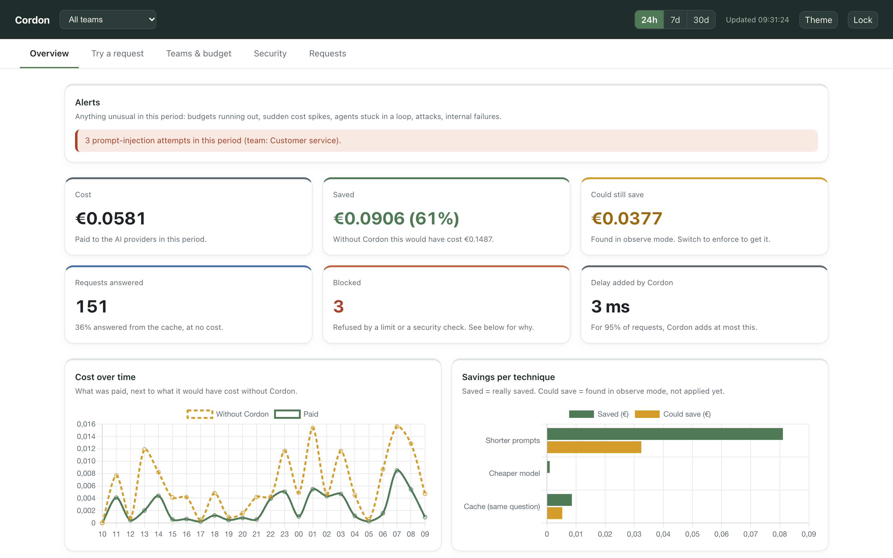
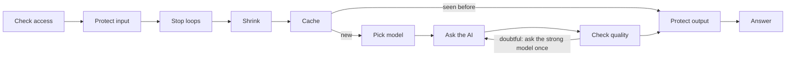
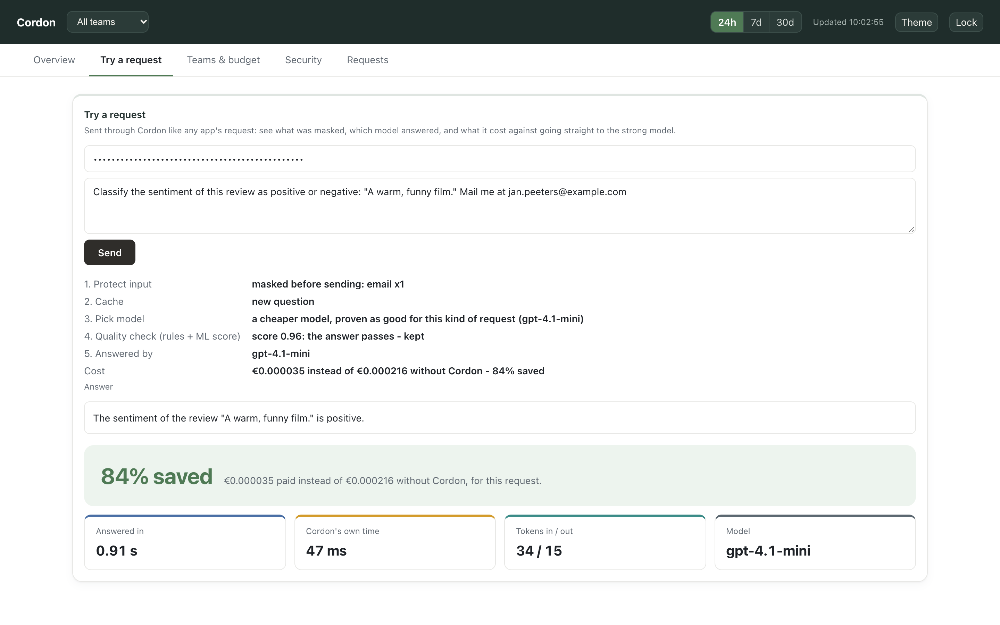
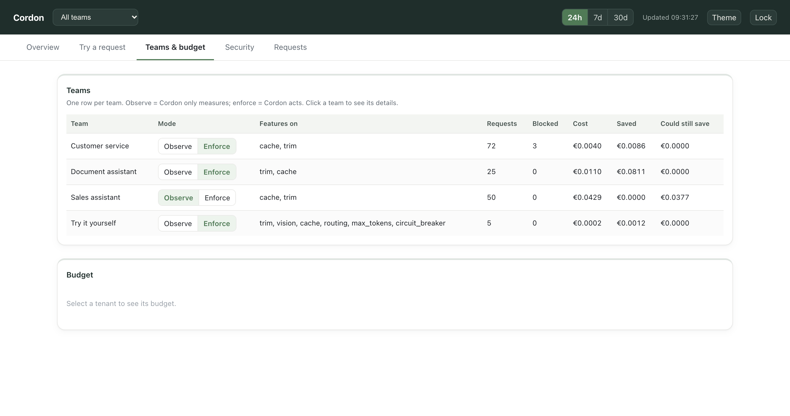

# Cordon — AI Cost & Data Gateway

**A self-hosted layer between a company's apps and AI models such as ChatGPT that protects personal data and cuts costs - and proves every saving with a measurement.**


> **In short:** every AI request from a company's apps passes through Cordon first. It masks
> personal data before it leaves the company, blocks manipulation attempts, keeps each team within
> its budget - and saves money: a cache for repeated questions, shorter prompts, smaller images,
> and a cheaper model **only where a benchmark on real models proved it as good**. If Cordon goes
> down, a failsafe sends requests straight to the provider, so the business never stops.



---

## What it does

- **Protects data:** emails, phone numbers, IBANs, national ID and card numbers become placeholders before a request leaves the company, and are put back in the answer.
- **Blocks manipulation:** prompt-injection attempts are flagged or blocked; leaks of the hidden instructions are redacted.
- **Saves money, measured:** 54% less on a simulated working day; a cheaper model is used only where it was proven as good on hundreds of real questions - see [A measured working day](#a-measured-working-day).
- **Controls spend:** a budget and rate limit per team, and a stop for AI agents stuck in a loop.
- **Shows it all:** a dashboard per team, with an *observe* mode that measures what Cordon *would* save before anything changes, and a panel to send a request and see what Cordon did.
- **Keeps working:** a failsafe in front of Cordon sends requests straight to the provider when Cordon is down.

## A measured working day

To see what Cordon saves on a company's bill, we **simulated one working day**: 300 requests built
from real, public data - texts to classify, customer-support questions (popular ones asked again
and again), support chats sent with their history, news articles to summarize. Every request was
sent **live to OpenAI twice**: straight to gpt-4o, as a company pays today, and through Cordon with
its savings on. The costs are **what OpenAI really billed**; every answer was scored the same way
(the known label, or the dataset's reference answer).

| Kind of request | Share of the bill | Saved | Quality (straight / Cordon) | How |
|---|---|---|---|---|
| Chats with history | 33% | 5% | 0.38 / 0.40 | the quality check sends most of them to gpt-4o |
| Support questions | 31% | 83% | 0.28 / 0.35 | repeats come from the cache; the rest from a cheaper model |
| Summaries | 26% | 75% | 0.46 / 0.45 | gpt-4.1-mini, proven as good on 365 articles |
| Classifying texts | 10% | 74% | 0.93 / 0.94 | gpt-4.1-mini, proven as good on 729 questions |
| **Whole day** | | **54%** | per kind within the noise at this size | EUR 0.64 straight vs EUR 0.30 through Cordon |

- It is one composed day, not a real company's traffic: a company saves more with many repeated
  questions, summaries or classifications, less with mostly long chats. `tools/audit.py` estimates
  it from a company's own logs.
- Quality scores have their own scale per kind (right/wrong for classification, closeness to a
  reference answer for the rest); per kind the differences are within the measurement's noise.
- A cheaper model is used only where it was proven as good on hundreds of real questions, and each
  route was confirmed on fresh questions fixed in advance. Requests recognised as arithmetic or
  code stay on gpt-4o. How every number was measured, and what it does *not* show:
  [docs/REFERENCE.md - Evidence](docs/REFERENCE.md#evidence). Repeat it: `python -m evaluation.company_day`.
- Answers are judged by an LLM (gpt-4o itself, which if anything favours its own answers); costs
  are OpenAI's list prices applied to the billed tokens.

## What I decided

Built with an AI coding assistant as the tool; the design calls were mine:

- **Every claim measured, or not made** - savings only from live runs, with the plan and the
  decision rule committed before the answers exist, and the result accepted either way.
- **The business never stops because of Cordon** - hence the failsafe that bypasses it when it is down.
- **Data protection before savings** - a broken security step stops the request; a broken saving never does.
- **No per-employee view** - monitoring staff needs a stated purpose, informed employees and, in
  Belgium, the works council (CAO 81); cost stays visible per team.
- **Semantic cache off by default** - measured: 1-5% of its hits answer a different question.
- **When two options score alike, the simpler one ships.**

## How it works



1. **Protect:** personal data is masked and manipulation attempts are caught before anything leaves.
2. **Save:** repeated questions come from an encrypted cache; duplicated text and oversized images are trimmed.
3. **Route:** a cheaper model answers only where it was proven as good; a small ML model (the quality check) sends any answer it doubts to the strong model.
4. **Account:** every request is booked - cost, what it would have cost, what was blocked - never its text.

If a money-saving step fails, the request goes through without that saving; if a security step fails, the request is stopped.



<details>
<summary>Teams, each in observe or enforce mode</summary>


</details>

## Tech stack

| Layer | Technology |
|---|---|
| Gateway | FastAPI, LiteLLM (OpenAI-compatible API) |
| Models | gpt-4o (strong), gpt-4.1-mini (proven route); Mistral supported |
| Quality check (ML) | scikit-learn classifier on answer features and the model's own confidence (logprobs) |
| Data protection | patterns plus checks (Luhn for cards, real digits for phones), AES-GCM encrypted cache |
| Storage | SQLite (ledger, teams, cache) |
| Dashboard | plain HTML/CSS/JS, Chart.js |
| Failsafe | nginx |
| Deployment | Docker Compose |
| Testing | pytest: 300+ offline tests, 5 live checks, a 10,000-request fuzz run |

## Getting started

No API key needed - in mock mode Cordon fakes the AI's answers.

```bash
python3.11 -m venv .venv
.venv/bin/pip install torch --index-url https://download.pytorch.org/whl/cpu
.venv/bin/pip install -r requirements.txt
.venv/bin/python -m tools.setup_models

.venv/bin/python -m tools.demo             # a real server, 10 scenarios: savings, cache, routing, blocking, privacy
.venv/bin/python -m tools.dashboard_demo   # the dashboard with demo teams; prints a key for "Try a request"
```

Apps use the normal OpenAI library with Cordon's address:

```python
client = OpenAI(api_key="<Cordon team key>", base_url="http://127.0.0.1:8787/v1")
```

Going live, team admin and deployment: [docs/REFERENCE.md](docs/REFERENCE.md#running-and-managing-cordon).

## Running the tests

```bash
.venv/bin/python -m pytest tests/              # offline
.venv/bin/python -m pytest -m live             # 5 live checks, needs OPENAI_API_KEY, < 1 cent
```

## Project structure

```
src/           the gateway: request pipeline, protection, savings, configuration, the trained check
tools/         what an operator runs: team admin, setup, the audit, the demos
evaluation/    the proof: benchmark, route proof, training, load and failsafe checks
notebooks/     the ML evaluations, with their results
tests/         the test suite
docs/          REFERENCE.md: every file, error code, design choice, failure mode, the evidence and limits
```

Also: [SECURITY.md](SECURITY.md) (threat model, data handling) and [reports/model_card.md](reports/model_card.md) (the quality check, measured).

## Status & next steps

A working, tested prototype; every number above was measured live on OpenAI (under EUR 10 in total) and can be repeated (`evaluation/company_day.py`). How each was measured, and what it does *not* show: [docs/REFERENCE.md - Evidence](docs/REFERENCE.md#evidence). In progress, each measured before it is switched on: a route for arithmetic (asked plainly, gpt-4o-mini comes close: 95% vs 97%), shorter chat histories, a batch mode for work that can wait - and a pilot on a company's own traffic, the real test of any route.

Reviewed in rounds by AI review agents (software and security, ML evaluation, a recruiter and a client's CTO); every confirmed bug has a regression test that fails without the fix.

## Author
**Domien Darmont** — Operational leader building applied AI systems, Antwerp, Belgium  
GitHub: [@DomienDarmontAntwerpen](https://github.com/DomienDarmontAntwerpen)  
LinkedIn: [Domien Darmont](https://www.linkedin.com/in/domien-darmont-b53b7640b/)

A live demo, the project presentation or answers to any questions are available on request.

## License
© 2026 Domien Darmont. All rights reserved.

The source code of this project is published for viewing and evaluation only. No permission is granted to copy, modify, distribute or use it, in whole or in part, without prior written consent from the author.

Third-party evaluation data in `data/` (questions from public datasets) remains under its own licence - see [docs/REFERENCE.md - Data sources](docs/REFERENCE.md#data-sources).
